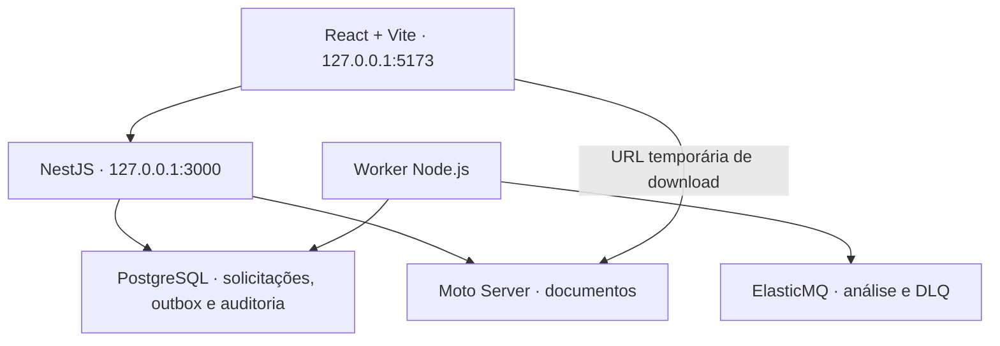

# AgroCredit Lab

**Projeto pessoal com emulação local de serviços AWS.** Laboratório educacional para cadastrar produtores sintéticos, organizar documentos e acompanhar solicitações de crédito rural com recomendação automática determinística e decisão humana auditável.

> Ambiente demonstrativo — dados e análises fictícios. Nenhuma operação financeira é realizada.

## Estado desta entrega

Consulte [VALIDATION.md](docs/VALIDATION.md) para os comandos efetivamente executados, resultados e bloqueios encontrados. Ter um teste implementado não significa que ele foi executado. A aplicação completa exige os componentes locais abaixo; a alternativa de contingência não é Moto nem ElasticMQ.

## Funcionalidades

- Sessões locais de uma hora, senhas com bcrypt (custo 12), revogação no logout e autorização no backend.
- Perfis solicitante e analista. O solicitante só acessa produtores, propriedades e solicitações que lhe pertencem.
- Cadastro de produtores/propriedades sintéticos e rascunhos editáveis. Valores financeiros `Decimal(16,2)` no PostgreSQL e strings decimais na API.
- Estados controlados, revisão humana com justificativa e histórico de ações com correlação.
- Filtros por produtor/finalidade/status, paginação e ordenação por data ou valor.
- Documentos PDF/PNG/JPEG de até 5 MiB; checagem de MIME, assinatura e tamanho; chaves UUID geradas pelo servidor e download por URL local pré-assinada de 60 segundos.
- Outbox transacional, worker independente, locks no PostgreSQL, idempotência persistida, três tentativas, DLQ e até três reprocessamentos justificados pelo analista.
- Dashboard, formulários, visualização de eventos, estados de carregamento/erro/vazio, navegação por teclado e layout responsivo.
- Contrato OpenAPI 3.0.3 em `/api/openapi.json`, referência local em `/api/docs`.

## Arquitetura local



API e worker são processos do mesmo monólito modular, compartilhando o domínio e adaptadores. `ObjectStore` e `QueuePort` são as interfaces; `MotoStore` e `ElasticQueue` implementam integrações locais. `domain.ts` concentra dinheiro, transições, documentos e recomendação. Os módulos de aplicação são autenticação, crédito e processamento, organizados por responsabilidade sem serviços extras.

## Requisitos

- Node.js 22.12+ ou 24 LTS, npm.
- Docker **Engine independente**, com Compose, em Linux/WSL; não instale nem use Docker Desktop.
- Alternativa sem contêiner: PostgreSQL 17, Python 3.12+ e OpenJDK 17+ (por exemplo Eclipse Temurin, código aberto). Veja abaixo.
- Internet só é necessária para obter os pacotes/imagens gratuitos, caso ainda não estejam disponíveis localmente. Em execução, os destinos da aplicação são exclusivamente locais.

Não são necessários conta AWS, cartão, cadastro externo, free tier ou serviços de IA. Os scripts não provisionam recursos nem fazem deploy. O compromisso é evitar cobranças de nuvem, licenças e APIs, não despesas de energia ou conexão do computador.

## Iniciar com Docker Engine

Execute dentro da pasta deste projeto:

```sh
npm ci --no-audit --no-fund
npm run setup
npm run build
npm start
```

`setup` gera `.env` ignorado pelo Git com senha aleatória local para PostgreSQL e gera o cliente Prisma. `start` verifica que o daemon não é Docker Desktop, sobe apenas PostgreSQL/Moto/ElasticMQ pelo Compose, aplica migrations, executa seed, inicia API, worker e Vite. Os logs ficam em `.local/`. O bucket e as filas são criados de modo idempotente no bootstrap; endpoints e credenciais fictícias estão explícitos em `.env.example`.

Abra [http://127.0.0.1:5173](http://127.0.0.1:5173), API em [http://127.0.0.1:3000/api/docs](http://127.0.0.1:3000/api/docs) e saúde em [http://127.0.0.1:3000/api/health](http://127.0.0.1:3000/api/health). Use `127.0.0.1`, incluindo na interface; origens diferentes são recusadas.

| Conta inteiramente fictícia | Perfil | Senha de demonstração |
| --- | --- | --- |
| solicitante@agrolab.test | Solicitante | Ficticio!2026 |
| analista@agrolab.test | Analista | Ficticio!2026 |
| outro@agrolab.test | Outro solicitante, para provar isolamento | Ficticio!2026 |

O seed não apaga dados existentes. Ele cria cenários e atualiza os hashes dessas contas. A senha de demonstração é pública por intenção educacional; nunca reutilize uma senha pessoal.

Para encerrar processos de aplicação, `npm stop`. Para encerrar também a infraestrutura local, `npm run infra:down`. Dados PostgreSQL do Compose permanecem no volume específico do projeto. O armazenamento padrão dos emuladores é efêmero: reiniciar Moto pode remover documentos; o histórico no PostgreSQL pode continuar apontando para anexos inexistentes. Reinicie os cenários ou anexe novamente durante a demonstração; não há durabilidade de produção.

### Sem Docker: serviços oficiais em processos locais

Use uma instalação local gratuita do PostgreSQL e um cluster **exclusivo deste projeto**, escutando em `127.0.0.1:55432`, usuário `agrolab`, banco `agrocredit`. Use a mesma senha criada em `.env`. Nunca reaproveite um banco de outra aplicação.

Crie um ambiente virtual Python e instale o Moto fixado:

```sh
python -m venv .local/moto-venv
# Linux/WSL
.local/moto-venv/bin/python -m pip install 'moto[server]==5.2.1'
.local/moto-venv/bin/moto_server -H 127.0.0.1 -p 5000
```

No Windows, os executáveis ficam em `.local\moto-venv\Scripts\`. Baixe o JAR `elasticmq-server-all-1.7.0.jar` da [release oficial](https://github.com/softwaremill/elasticmq/releases/tag/v1.7.0), coloque-o em `.local/` e execute com OpenJDK:

```sh
java -Dconfig.file=config/elasticmq.conf -jar .local/elasticmq-server-all-1.7.0.jar
```

Para processos nativos, altere **somente** `rest-sqs.bind-hostname` para `127.0.0.1` no arquivo de configuração; em contêiner ele usa `0.0.0.0` internamente com publicação restrita a loopback. Depois, em terminais separados:

```sh
npm run setup
npm run build
npm run db:migrate
npm run db:seed
npm run api
npm run worker
npm run web
```

### Contingência inteiramente local

Se não for possível instalar Moto/ElasticMQ, há um **adaptador de contingência próprio**, com um subconjunto HTTP S3/SQS, sem dependências Python adicionais. Ele existe para permitir exercícios do domínio em ambientes restritos. Não deve ser apresentado como teste realizado com Moto/ElasticMQ, tampouco como compatibilidade AWS geral. Os dados de negócio continuam no PostgreSQL/Prisma; o SQLite interno guarda somente objetos/mensagens do adaptador.

Após instalar Node, Prisma e PostgreSQL, execute:

```sh
npm start -- --portable --fallback
npm run infra:down -- --portable --fallback
```

No Windows o controlador encontra `C:/Program Files/PostgreSQL/17/bin`; em outros locais, defina `PG_BIN` ou tenha os binários no PATH. Ele cria o cluster em `.local/pg`, sem tocar em instalações de dados existentes. `PYTHON` permite escolher o executável Python. A contingência usa `.local/fallback/emulation.sqlite`, binding loopback e os mesmos endpoints locais. Ela valida a assinatura de GET pré-assinado, mas não implementa IAM, todas as operações S3, políticas de segurança AWS, retenção de SQS ou compatibilidade completa de protocolo. Ela não torna disponíveis os binários do Prisma caso estes também estejam ausentes.

## Testar

```sh
npm test
npm run build
# instala apenas o navegador aberto e gratuito necessário, se ainda não disponível
npx playwright install chromium
# inicia infraestrutura isolada, migra, faz seed, testa API e depois UI com worker
npm run test:integration
# alternativa explícita para a contingência
npm run test:integration -- --portable --fallback
# encerra somente os serviços isolados de teste
npm run infra:down -- --test
```

`npm test` executa testes unitários sem serviços. As suítes de integração e contratos HTTP só são habilitadas explicitamente. `test:integration` usa `agrocredit_test` em **55433**, Moto em **15000**, ElasticMQ em **19324**, API em **13000**, Vite em **15173**. A verificação de configuração rejeita serviços de desenvolvimento quando `NODE_ENV=test`. Não há `migrate reset`, `DROP DATABASE` ou remoção de dados de desenvolvimento no teste. Falhas preservam trace e logs; não converta falhas de inicialização em sucesso.

Para executar E2E separadamente depois de iniciar o conjunto de teste, use `npm run test:e2e`. `npm run test:integration` coordena tudo automaticamente. O E2E cobre login, rascunho, upload, download, fila/worker, troca de perfil, decisão, auditoria e viewport móvel. Capturas, quando esse fluxo realmente passa, são gravadas em `docs/screenshots/`; traces de falhas ficam em `test-results/`.

Detalhes e matriz: [TESTING.md](docs/TESTING.md). Explicações de arquitetura, S3, SQS, tentativas e limitações: [ARCHITECTURE.md](docs/ARCHITECTURE.md). Chamadas HTTP: [API.md](docs/API.md). Roteiro e entrevista: [DEMO.md](docs/DEMO.md).

## Remover somente os dados deste projeto

**Aviso: perda irreversível dos dados locais deste laboratório.** Encerre a aplicação antes. Verifique o diretório atual e o nome do projeto; não use comandos globais de prune nem remova volumes de outros projetos.

Para o Compose de desenvolvimento, execute dentro da pasta AgroCredit Lab:

```sh
npm stop
docker compose -p agrocredit-lab -f compose.yml down --volumes
```

Para o conjunto isolado de testes:

```sh
npm stop -- --test
docker compose -p agrocredit-lab-test -f compose.test.yml down --volumes
```

Para o modo portátil, primeiro `npm run infra:down -- --portable --fallback` (e `--test` para teste). Depois apague manualmente, pelo explorador de arquivos, **apenas** `.local/pg` e `.local/fallback` dentro deste projeto, ou `.local/pg-test` e `.local/fallback-test` para o conjunto de testes. Nunca apague `C:/Program Files/PostgreSQL`, um cluster global, o diretório pai ou dados de outros projetos. Preservar `.env` mantém a configuração local; se o remover, execute `setup` para gerar nova senha antes de criar um cluster novo.

## Segurança e observabilidade

`configuration()` falha antes de abrir conexões se S3/SQS não forem HTTP no IP literal loopback e portas permitidas, se o PostgreSQL não estiver nos destinos autorizados, se as credenciais S3 não forem as fictícias ou se houver `AWS_PROFILE`/`AWS_SESSION_TOKEN`. Não há cadeia de resolução de credenciais AWS no adaptador; o S3Client recebe credenciais estáticas fictícias. O cliente SQS usa HTTP Query diretamente no endpoint validado, sem credenciais reais e sem redirects. Nenhum SDK de provisionamento está incluído.

Logs JSON registram ação técnica, status, eventId e correlationId; não incluem senha, token, corpo HTTP, arquivo ou URL assinada. O histórico de negócio fica no PostgreSQL. `/api/health` testa banco, bucket, fila e heartbeat do worker (15 segundos). Não há analytics, fontes baixadas, scripts de CDN ou APIs externas na interface.

O controle de documentos é demonstrado na **API**, antes de acessar o objeto ou emitir URL. Moto e ElasticMQ não constituem isolamento seguro contra outro processo executado no mesmo computador: quem tem acesso ao emulador pode manipular os dados. Não use documentos reais; emulação não valida IAM ou a privacidade real do S3. A checagem de assinatura de arquivo não é um antivírus.

## Como seria na AWS — somente conceitual

| Componente local | Correspondência conceitual |
| --- | --- |
| Moto Server | Bucket S3 privado para documentos, políticas e criptografia a definir |
| ElasticMQ + DLQ | SQS para análise e fila de mensagens mortas |
| API NestJS e worker | Processos em EC2 ou tarefas ECS, escalados separadamente |
| PostgreSQL local | RDS PostgreSQL com backups e controle de acesso |
| Autorizações estáticas locais | IAM com funções de execução e menor privilégio |
| Logs JSON e heartbeat | CloudWatch Logs, métricas, alarmes e tracing |

Essa comparação não é um deploy realizado, nem validação operacional. TLS, rede privada, IAM real, backups, gestão de segredos, métricas e resposta a incidentes exigiriam um projeto separado. Não há comandos de provisionamento nem workflows de deploy neste repositório.

## Versões e fontes oficiais

Versões JavaScript estão fixadas em `package.json` e no lockfile; consulte [VERSIONS.md](docs/VERSIONS.md). Moto Server e ElasticMQ são projetos sob Apache-2.0, sem conta/ativação obrigatória para as distribuições abertas escolhidas, conforme [licença Moto](https://github.com/getmoto/moto/blob/master/LICENSE) e [licença ElasticMQ](https://github.com/softwaremill/elasticmq/blob/master/LICENSE.txt). As versões das imagens são fixadas; disponibilidade de pull precisa ser verificada em um ambiente que permita o download.

Documentação consultada em 20/11/2026: [NestJS](https://docs.nestjs.com/security/authentication), [validação Nest](https://docs.nestjs.com/techniques/validation), [Prisma 6](https://www.prisma.io/docs/orm/v6/prisma-client/queries/transactions), [React](https://react.dev/learn), [Vite](https://vite.dev/guide/), [PostgreSQL](https://www.postgresql.org/docs/17/datatype-numeric.html), [Moto Server](https://docs.getmoto.org/en/latest/docs/server_mode.html), [ElasticMQ](https://github.com/softwaremill/elasticmq), [Playwright](https://playwright.dev/docs/writing-tests), [S3 URLs assinadas](https://docs.aws.amazon.com/AmazonS3/latest/userguide/using-presigned-url.html), [SQS visibilidade](https://docs.aws.amazon.com/AWSSimpleQueueService/latest/SQSDeveloperGuide/sqs-visibility-timeout.html).

## Texto honesto de portfólio

> AgroCredit Lab: projeto pessoal com emulação local de serviços AWS. Plataforma educacional de crédito rural com NestJS, TypeScript, React, PostgreSQL/Prisma, documentos em armazenamento compatível com S3 e processamento assíncrono compatível com SQS. Implementa autorização no backend, outbox, idempotência persistida, retries, DLQ e histórico auditável. Dados e análises fictícios; execução exclusivamente local.

Use o relatório de validação para informar quais partes você efetivamente executou. Não apresente o laboratório como experiência profissional, deploy real ou operação em produção na AWS.
