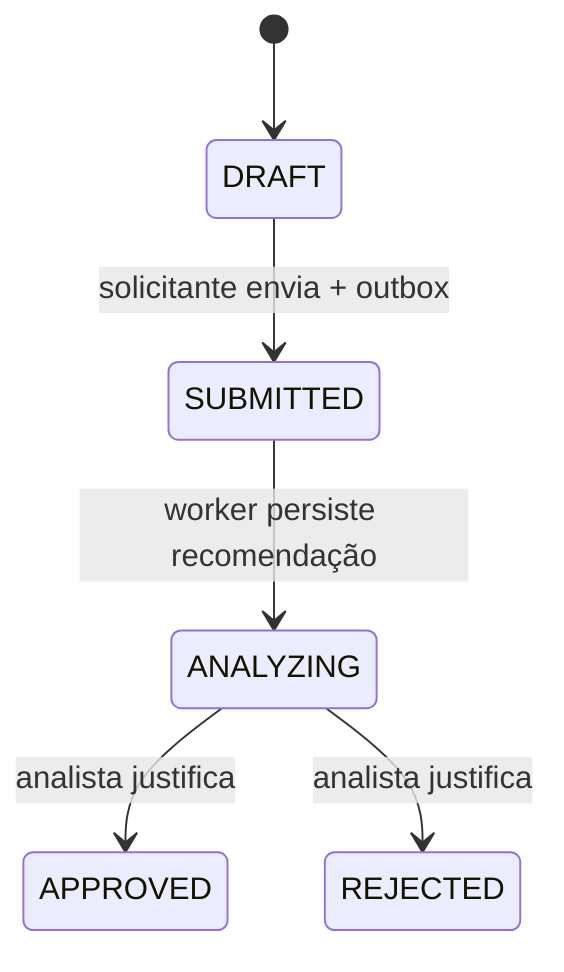

# Decisões técnicas e limitações

## Fluxo e consistência

O solicitante cria um rascunho com valores financeiros sintéticos. O backend permite editar apenas rascunhos. Ao enviar, abre uma transação PostgreSQL, bloqueia a solicitação, valida `DRAFT → SUBMITTED`, grava a mudança, a auditoria e um `AnalysisEvent` na outbox. A API não precisa de uma transação distribuída entre banco e fila.

O worker consulta a outbox, publica `{eventId, requestId, correlationId}` e só então grava `dispatchedAt`. Se morrer entre publicação e atualização, pode publicar de novo. Essa duplicação é esperada e segura para os efeitos de negócio implementados. A fila é de entrega pelo menos uma vez; não prometemos entrega exatamente uma vez.

O consumidor trava primeiro a linha da solicitação, depois a do evento, sempre nessa ordem. Se `processedAt` já existir, não recalcula nem cria outra auditoria. Caso contrário, calcula a recomendação, registra `ANALYZING`, incrementa versão, insere auditoria e salva `processedAt` e a tentativa **na mesma transação**. Só depois do commit confirma a mensagem na fila. Duas entregas concorrentes do mesmo evento são serializadas pelos locks.

`ANALYZING` significa recomendação disponível, aguardando análise humana. Não há aprovação automática. As linhas de demonstração em estados avançados são identificadas por `DEMO_SEEDED`; não simulam uma sequência histórica que não aconteceu.

## S3 e documentos

S3 é um armazenamento de objetos identificados por bucket e chave; não é um sistema de arquivos POSIX. O projeto usa `requests/<uuid>/<uuid>` para nunca confiar em caminhos enviados pelo cliente. O backend verifica proprietário e papel, valida tamanho/MIME/magic bytes e envia o objeto pelo adaptador. Se a transação de metadados falhar, tenta remover o objeto; se o processo morrer nessa janela, pode sobrar um objeto órfão. Uma coleta periódica seria uma evolução, não parte do MVP.

O download exige nova autorização na API, que registra emissão de URL e produz SigV4 com validade de 60 segundos. A URL é um segredo temporário transferível: qualquer pessoa que a possua pode usá-la durante sua validade. Não é revogada automaticamente pelo logout. O log não registra a URL. O upload passa pela API para que limites e assinatura de conteúdo sejam verificados antes da gravação; somente o download usa URL pré-assinada.

Moto reproduz chamadas S3, mas não deve ser usado para provar que IAM, criptografia, bloqueio de acesso público ou assinaturas são aplicados como na AWS. O fato de o emulador escutar só no loopback reduz exposição de rede; não cria uma fronteira de segurança contra outros programas locais. Arquivos devem ser fictícios.

## SQS, retries, timeout e mensagens mortas

SQS é uma fila; uma mensagem recebida permanece nela até `DeleteMessage`. `VisibilityTimeout=15` segundos oculta temporariamente a mensagem do próximo consumidor. Se o worker morrer ou não confirmar, ela reaparece. O processamento determinístico ocorre em uma transação com limite de 5 segundos, abaixo dessa janela; HTTP tem timeout de 5 segundos. Jobs longos exigiriam extensão de visibilidade, não implementada neste MVP.

Falhas de análise incrementam `attempts` e inserem `Attempt` e `Audit` em transação separada, sem expor stack/payload. Nas duas primeiras, a mensagem não é confirmada e retorna após o timeout. Na terceira, `deadAt` é persistido e uma cópia de metadados vai à DLQ; só após essa publicação a mensagem original é confirmada. Se a publicação na DLQ falhar, ela permanece na fila principal; uma entrega posterior vê `deadAt` e tenta novamente. Pode haver mais de uma cópia na DLQ se houver falha entre enviar e confirmar. Isso não duplica a recomendação nem auditoria de sucesso.

A política do broker tem `maxReceiveCount=5` como proteção adicional quando nem o banco consegue registrar a tentativa. Nesse caso a mensagem pode ir para DLQ pelo broker sem `deadAt` no banco; inspeção e recuperação manual seriam necessárias. O painel de reprocessamento cobre eventos mortos persistidos pelo aplicativo, não toda forma de falha catastrófica. Mensagens inválidas são colocadas em quarentena com messageId e tipo de falha, sem copiar conteúdo não confiável.

O reprocessamento exige analista, justificativa com pelo menos dez caracteres, evento morto ainda sem sucesso, solicitação não decidida e limite de três reprocessamentos. O mesmo eventId é reutilizado, o contador atual é zerado e o histórico de tentativas anteriores permanece. A outbox volta a despachar. A DLQ histórica não é esvaziada automaticamente; a cópia é evidência da falha anterior.

## Por que PostgreSQL e Decimal

`NUMERIC(16,2)` armazena dinheiro com precisão decimal; a API recebe strings com duas casas. O domínio usa `Prisma.Decimal` e evita `number` nos cálculos. A interface usa `Number` somente para exibição em BRL, não para a recomendação nem persistência. O banco também impõe valor positivo, prazo de 1–120 meses e justificativa em decisões finais. Migrations contêm constraints adicionais que o esquema Prisma não expressa.

Locks pessimistas são suficientes para este monólito e tornam decisões concorrentes e eventos duplicados previsíveis. Versão incrementada serve ao histórico; ela não é um protocolo completo de edição otimista de rascunhos. Auditorias são append-only pelo código de aplicação; não há mecanismo de imutabilidade contra administrador do banco, assinatura criptográfica ou WORM.

## Comparação de execução

| Aspecto | Moto/ElasticMQ locais | Contingência própria | AWS real, apenas conceitual |
| --- | --- | --- | --- |
| API | Subconjuntos compatíveis S3/SQS | Somente operações usadas no MVP | Serviço gerenciado completo |
| Identidade | Credenciais fictícias | Credenciais fictícias | IAM e credenciais temporárias |
| Rede | Loopback publicado | Loopback nativo | VPC/endpoints/TLS a projetar |
| Durabilidade | Emuladores efêmeros nesta configuração | SQLite local de objetos/mensagens | Garantias específicas dos serviços |
| Disponibilidade | Um computador | Um computador | Domínios de falha e SLAs do serviço |
| Segurança validada | Regras da aplicação | Regras e subconjunto do adaptador | Exigiria testes AWS e revisão própria |
| Cobrança de serviço | Nenhuma conta de nuvem | Nenhuma conta de nuvem | Não utilizado por este projeto |

## Escolhas de escopo

- Sessão opaca com token em memória do navegador, hash SHA-256 no banco e expiração de uma hora, evitando JWT e armazenamento persistente de tokens no browser.
- bcrypt puro JavaScript para instalar em Windows/Linux sem toolchain nativa; custo 12. Limitação explícita de 72 bytes nas senhas evita truncamento do algoritmo.
- Sem e-mail, recuperação externa de senha, MFA, IA, analytics, Kubernetes ou microsserviços adicionais.
- OpenAPI é gerado pelo código de documentação e DTOs, sem CDN. A referência visual é própria; não inclui o pacote Swagger UI. Respostas do contrato são descritas genericamente, sem um catálogo completo de todos os esquemas de retorno.
- Adaptadores expõem interfaces pequenas; o Nest injeta implementações locais. Não há seletor que autorize endpoints de nuvem.
- O Compose sobe só infraestrutura local; API/frontend/worker ficam no host. Credenciais do banco são aleatórias e ficam em `.env` ignorado pelo Git.
- Testes de produção, carga, disaster recovery, IAM real e segurança de infraestrutura ficam fora do escopo.
