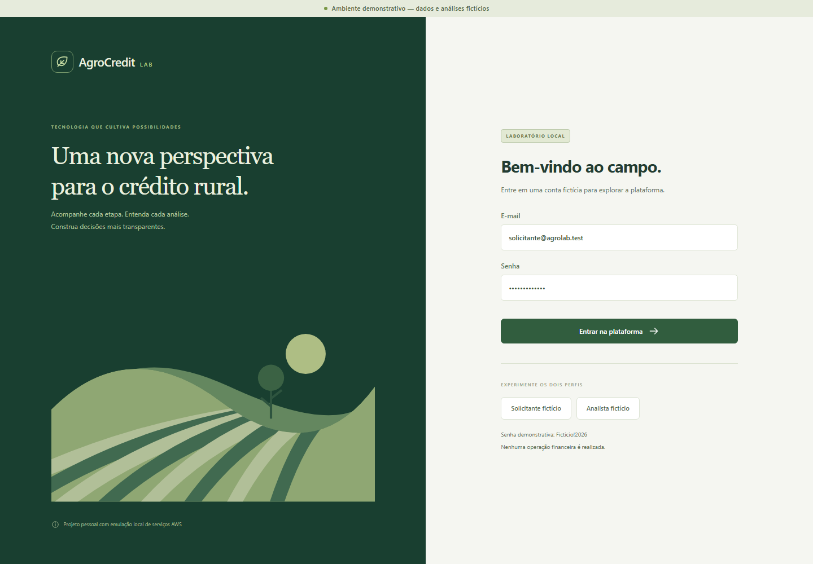
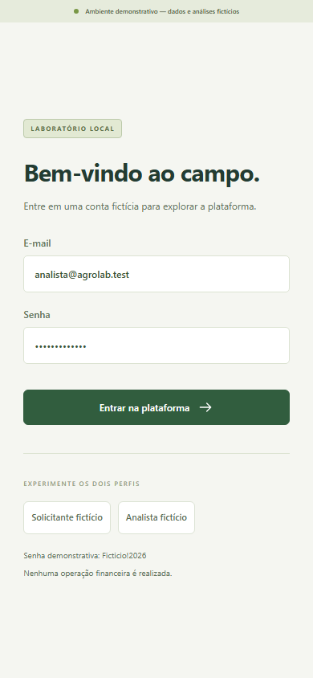

# Validação executada — 20/11/2026

## Resultado honesto

O código dos componentes solicitados foi implementado e compila. **A execução completa da API/worker e da jornada de crédito ainda não foi validada neste ambiente**, porque faltam binários do Prisma e os downloads externos por processos locais foram bloqueados. Não se deve apresentar esta entrega como uma aplicação integralmente validada ponta a ponta.

Nenhuma conta AWS, credencial real, API paga, licença comercial, recurso em nuvem, deploy ou Docker Desktop foi utilizada. Consultar documentação pública e baixar dependências gratuitas são ações diferentes de provisionar serviços. A instalação JavaScript foi viabilizada com pacotes já existentes no cache local, sem alterar o cache de origem. URLs temporárias usadas para essa instalação foram removidas do lockfile final; o projeto entregue referencia o registry público oficial do npm.

## Verificações que passaram

| Verificação | Resultado e evidência |
| --- | --- |
| Backend TypeScript | Compilação `tsc -p tsconfig.json` aprovada |
| Frontend TypeScript | Compilação `tsc -p web/tsconfig.json` aprovada |
| Bundle React/Vite | `npm run build` aprovado; HTML/CSS/JS gerados em `dist/web` |
| Jest unitário | **46 testes aprovados**, cinco suítes: domínio, segurança de configuração, autenticação, autorização de documentos e contrato de confirmação do worker |
| S3 HTTP | Um teste aprovado com SDK S3 real contra o **adaptador próprio de contingência**: criação de bucket, upload, URL SigV4, download e exclusão do objeto de teste |
| SQS HTTP | Um teste aprovado contra a **contingência**: envio, recebimento, invisibilidade temporária e confirmação |
| PostgreSQL real | PostgreSQL 17.10 iniciado em cluster exclusivo, loopback 55433; banco `agrocredit_test` |
| Migration SQL | SQL inicial executado com sucesso dentro de transação descartável no banco isolado |
| Contrato SQL | Precisão `99999999999999.99` e `0.10+0.20`, constraints de valor/justificativa, referências e rollback verificados; transação revertida incluindo o esquema de teste |
| Playwright | **Um teste aprovado da tela real de acesso**, Chromium, desktop 1440×1000 e celular 390×844, seleção de perfil, sem erro JavaScript e sem overflow horizontal |
| Capturas reais | `screenshots/login-desktop.png` e `screenshots/login-mobile.png`; somente a tela de acesso, sem backend conectado e sem respostas de API simuladas |

Para possibilitar compilação e testes puros, foi gerado localmente um cliente Prisma **sem engine**, com o compilador WASM disponível no pacote. Isso valida tipos e código de domínio, **não consultas Prisma**. Essa instalação auxiliar não faz parte do código entregue: o usuário deve executar `npm ci` e `npm run setup` normalmente para obter o cliente e os binários corretos. Nenhum stub de banco foi usado para fazer a API parecer operacional.

## Bloqueios observados

- Conexões externas de processos locais a `registry.npmjs.org` e `binaries.prisma.sh` retornaram erro de acesso a sockets (`EACCES` / `WinError 10013`). O npm foi recuperado por cache; os binários `schema-engine.exe` e `query_engine.dll.node` não estavam disponíveis.
- `npm run test:integration -- --portable --fallback` foi **realmente tentado** e encerrou com erro na geração Prisma, antes de iniciar o fluxo de integração. Não foi marcado como aprovado.
- Docker CLI/Compose estavam instalados, mas não havia daemon Docker Engine independente em execução. Docker Desktop não foi iniciado nem utilizado.
- Moto Server não estava instalado; OpenJDK/ElasticMQ não estavam disponíveis. Documentação e licenças foram consultadas; imagens e distribuições estão configuradas, mas **não houve execução dos emuladores oficiais**.
- A primeira tentativa com `pg_ctl start` falhou por criação de token restrito no Windows. Executar `postgres` diretamente permitiu iniciar o cluster exclusivo e realizar os testes SQL; o controlador portátil foi ajustado para essa forma de inicialização.

## O que permanece sem aprovação

| Item implementado | Por que não foi validado integralmente |
| --- | --- |
| Sessão HTTP real, CRUD e decisão via NestJS/Prisma | API não pôde conectar pelo engine Prisma ausente |
| Outbox, locks concorrentes e idempotência persistida | Exigem a suíte de integração Prisma/PostgreSQL; mocks unitários só provam contratos de chamada |
| Retries persistidos, DLQ e reprocessamento com banco | Suíte implementada, mas bloqueada antes da inicialização |
| SDK S3 com Moto e SQS com ElasticMQ | Contratos foram exercitados somente com contingência própria |
| Jornada completa no navegador | `e2e/main.spec.ts` está implementado, mas não foi executado com uma API funcional |
| Docker Compose e pulls das imagens fixadas | Sem Docker Engine independente disponível |

Em uma execução padrão de `npm test`, sete testes de integração/contrato ficam explicitamente **skipped** quando não habilitados; os 46 unitários passam. Os dois contratos HTTP foram habilitados e executados separadamente no conjunto local de contingência. Um teste aprovado da tela de acesso não equivale ao E2E completo.

## Como concluir a validação em um computador sem esses bloqueios

1. Instale as dependências gratuitas com `npm ci`; os binários Prisma precisam poder ser baixados do distribuidor oficial, sem conta nem cobrança.
2. Execute `npm run setup` e `npm run build`.
3. Inicie Docker Engine independente ou os processos nativos Moto, ElasticMQ/OpenJDK e PostgreSQL conforme README.
4. Execute `npm run test:integration` para os emuladores oficiais. A alternativa `--portable --fallback` testa somente a contingência e deve continuar identificada dessa forma.
5. Execute `npm start` e siga o roteiro de cinco minutos. Só após o resultado real, registre a jornada e as capturas do dashboard e da decisão.

## Capturas da tela real verificada

